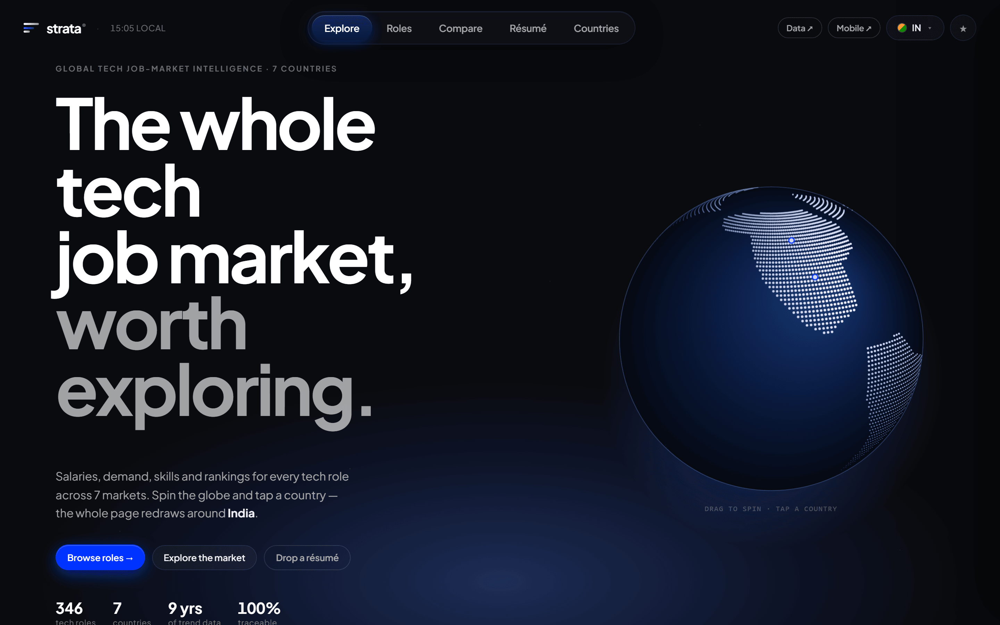
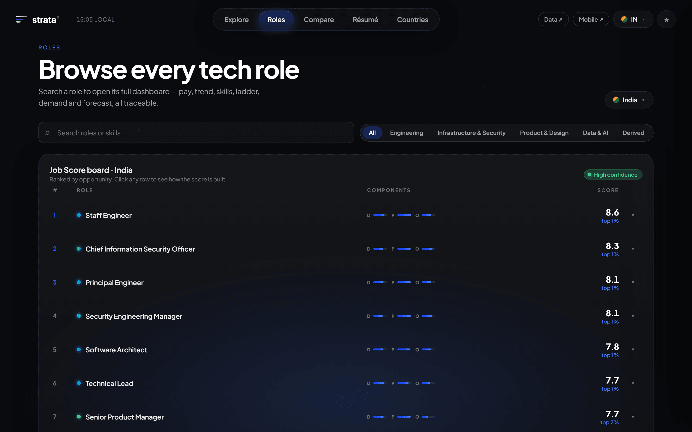
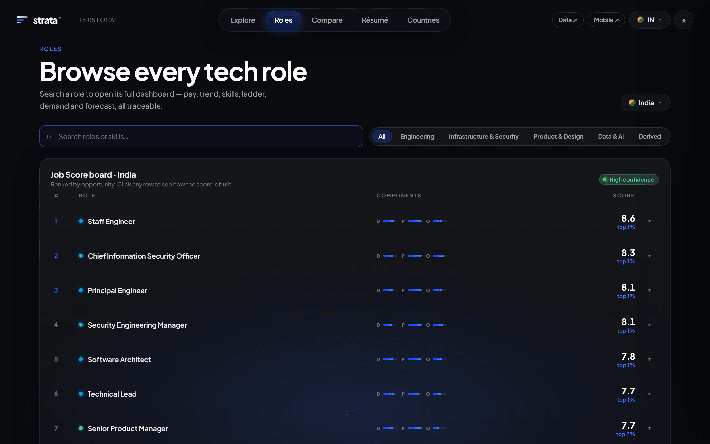
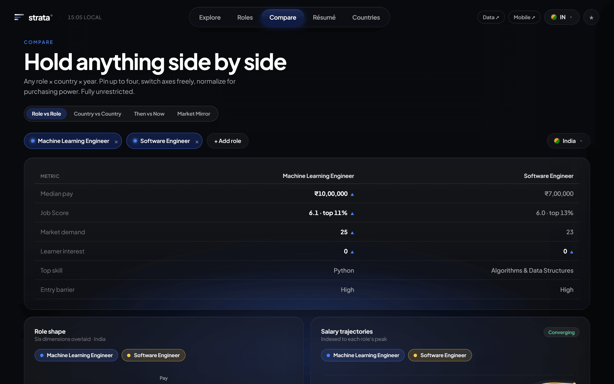
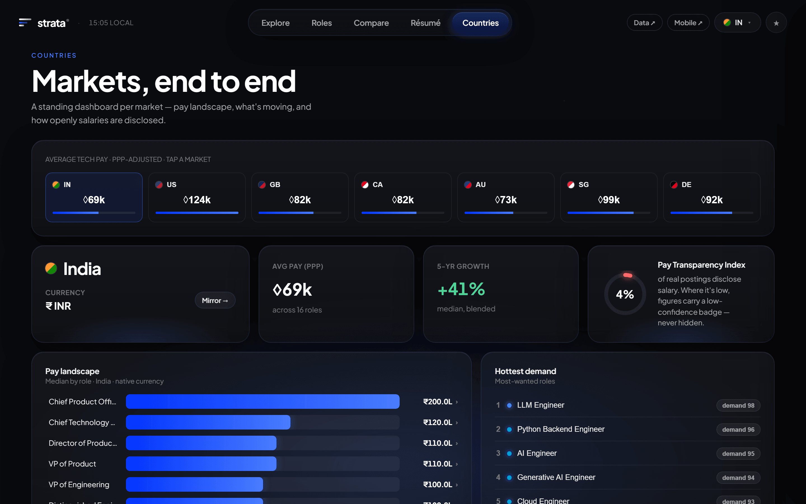

# strata

**An honest, roles-only explorer of the global tech job market — real salaries, demand, skills, career ladders and experience curves for any tech role, across 7 countries.**

<p align="center">
  
  
  
  
</p>

> Search **any** tech-or-adjacent role, in **your** country (India — deep — plus the US, UK,
> Canada, Australia, Singapore, Germany), and get everything you need to *choose it*: what it
> pays (three independent salary lenses, never blended), how demand is moving, the skills that
> matter, the career ladder above it, and how pay grows with experience — every number
> source-labeled, sample-sized, and traceable, with an honest **"not enough data"** where the
> data is thin. Never fabricated. Never borrowed across countries.

---

## Why it exists

strata is the tool its author wishes he'd had: someone capable but stuck, spending money on
courses in domains that didn't fit, unable to choose a path because role information was
fragmented and untrustworthy. So the whole product is built around one litmus test — *does this
help a person choose a role?* — and one non-negotiable value:

**Honesty over impressiveness.** Real data where it's real, "not enough data" where it's thin,
never fabricated, never borrowed across markets. A confidently-wrong number could send someone
down the wrong path — the exact harm strata exists to prevent. See [`SCOPE.md`](SCOPE.md) for the
full charter and [`IDEOLOGY.md`](IDEOLOGY.md) for how the data philosophy evolved.

**Roles-only, always.** strata is about *roles and the work* — never employers. There are no
company pages, no employer ratings, no "best places to work." Company is internal dedup plumbing,
never a product axis.

---

## What's inside

### Three salary lenses, never blended
Every role × country carries up to three independent salary reads, each with its own currency,
year, source and sample size — shown side by side, never averaged into a single fake number:

| Lens | Meaning | Example source |
|---|---|---|
| **Advertised** | what employers post | Adzuna |
| **Realized** | what people actually earn | Stack Overflow survey · US H-1B/OFLC disclosures |
| **Official** | national statistical wages | BLS OEWS · ONS ASHE · Eurostat · ILOSTAT · MOM · … |

Cross-country fairness is handled with a **PPP toggle**, never live FX.

### The signals behind every role
- **Demand** — real posting volume (Common Crawl) + developer activity (GH Archive)
- **Interest** — career-search interest (Google Trends)
- **Job Score** — an explainable demand / pay / opportunity composite, with percentile + component breakdown
- **Skills & durability** — extracted per role, graded core-vs-peripheral, with adoption/emergence signals
- **Trajectory & ladders** — where a role leads (O\*NET / ESCO / Wikidata occupation graph) and the pay rungs above it
- **Experience curves** — pay vs years-of-experience per role×country, fitted monotone with confidence bands (answer *"what at 5 years?"* for any role that has data)
- **Transparency** — a per-market Pay Transparency Index

### The differentiator: LLM extraction (roles-only, abstain-capable)
A keyword matcher can tell you the word "Python" appears in a posting. It can't tell you the title
says "Engineer" but the body is a support queue, or that a posting is too thin to claim anything
at all. strata reads the **full text** of every posting with a local LLM (Ollama · qwen3:8b,
grammar-constrained JSON) into a **19-field, roles-only schema** — disambiguated role, seniority,
IC-vs-management track, years required, skills, education gate, certifications, work arrangement,
on-call load, and honest **abstain** flags. Validated without hand-labeling (ground-truth crosswalks
+ a stronger-model judge + self-consistency).

### Aggregator estimates (role × experience-year)
Published datasets never reach *"Data Scientist, 5 years, India."* strata also ingests the
pre-computed estimates aggregators publish (e.g. AmbitionBox — per-year experience), landing them
as their **own labeled lens** (`kind=estimate`), never blended into the others.

---

## Features

| Capability | How it works |
|---|---|
| Three salary lenses | Advertised, reported and aggregator-estimated pay kept as separate facts and never blended into one number |
| Roles-only charter | The schema has no employer dimension; salaries attach to roles and markets, never to a named company |
| Abstain-capable extraction | Grammar-constrained LLM extraction into a 19-field schema that declines to guess rather than filling a field |
| Provenance on every figure | Each number carries source, sample size, freshness and lens, reachable from a confidence badge |
| PPP cross-country comparison | Purchasing-power adjustment for cross-market comparison; native currency everywhere else, never live FX |
| Honest sparsity | Where a role x country cell is too thin the UI says so instead of interpolating |
| Demand and interest series | Posting volume and search interest tracked alongside pay, so a rising salary can be read against rising demand |
| Résumé valuation | A dropped résumé is scored per market with a skills-gap plan |

## Screenshots

### Explore



The entry surface. A dotted globe drives the whole page — tapping a country redraws
every panel around that market. The counters are the live dataset: 346 tech roles
across 7 countries with 9 years of trend data.

### Roles



The searchable role index with the explainable Job Score board. Scores decompose
into their components rather than arriving as a single opaque ranking.

### Role dashboard



The deep view for one role: three-lens salary, salary over time, demand trajectory
with a forecast band, skills and their durability, the pay ladder, and a PPP-fair
cross-country strip.

### Compare



Up to four role x country x year combinations pinned side by side, with per-chart
series selection and a nominal/PPP toggle.

### Countries



Per-market dashboards and the Pay Transparency Index — how much of each market's
posting volume discloses pay at all.

---

## Architecture

```
             INGEST                       WAREHOUSE                 SERVE            APP
  29 connectors  ──►  staging/  ──►  DuckDB star schema  ──►  SQLite marts  ──►  FastAPI  ──►  Vite + React
  (fetch-once,        (parquet /     (30 tables: 3 salary     (16 read-model    (/api/         (desktop +
   resumable,          json cache)    lenses, demand,          tables)           dataset)       mobile)
   polite)                            interest, skills,
                        ▲              ladders, curves, …)
                        │
          GPU / LLM stage: Ollama extraction → skill-norm →
          entity-resolution → role-derivation (RTX 5080)
```

- **Ingestion** — 29 source connectors, each idempotent, resumable (cache *is* the checkpoint), and
  credential-graceful (missing keys skip + flag, never halt). Orchestrated by `collect_all` with
  per-stage budgets. Sources include Adzuna, Stack Overflow survey, DOL H-1B/OFLC, Common Crawl,
  GH Archive, Google Trends, official statistics (BLS/ONS/Eurostat/ILOSTAT/MOM/…), Wikipedia/
  Wikidata, package registries, arXiv, HuggingFace, and AmbitionBox.
- **Warehouse** — a DuckDB star schema (30 tables): three salary-lens facts, demand, interest,
  skill adoption, role-outlook, forecasts, plus the v2 experience/ladder substrate
  (`fact_salary_yoe_obs`, `bridge_seniority_yoe`, `fact_salary_curve`, `dim_ladder_rung`, …).
  Fused deterministically by lens precedence; sanity-bounded; every fact source-labeled.
- **Marts** — 16 SQLite read-model tables materialized for the API, with a run-gate that validates
  before publish.
- **App** — a FastAPI service exposes `/api/dataset`; the Vite + React frontend hydrates a single
  `STRATA` object and renders it across five surfaces.

**Stack:** Python 3.13 · FastAPI · DuckDB · SQLAlchemy/SQLite · pandas · scikit-learn · scipy ·
Ollama (local LLM) · sentence-transformers · Vite · React 18.

---

## The app — five surfaces

- **Explore** — an interactive dotted-world globe (drag to spin, tap a country to redraw the whole
  page), Market Pulse (hottest / highest-paid / fastest-rising / top-score), and a live free-axis
  canvas with inline-expanding trends.
- **Roles** — searchable index, the explainable **Job Score board**, and the deep **Role Dashboard**:
  three-lens salary, salary-over-time, demand trajectory with an honest forecast band, skills +
  durability, the pay ladder, demand-vs-interest, and a PPP-fair cross-country strip.
- **Compare** — pin up to 4; any role × country × year, with per-chart series selection and a
  Nominal/PPP toggle.
- **Résumé** — drop a résumé → whole-profile valuation per country, PPP best-market ranking, role
  matches, a skills-gap plan, and an opt-in A-vs-B.
- **Countries** — per-market dashboards + the Pay Transparency Index.

Every figure carries a clickable **confidence badge → provenance** (source, sample size, freshness,
lens). Currencies shown natively; cross-country comparison via PPP, never live FX.

---

## Getting started

### 1. The app (frontend + API)

```bash
# frontend
npm install
npm run dev            # desktop http://localhost:5173/  ·  mobile /mobile.html

# backend API (separate terminal)
pip install -r backend/requirements.txt
python -m backend.cli init-db            # create the serving schema
python -m backend.cli marts-materialize  # warehouse → serving marts
python -m backend.cli serve              # FastAPI on http://127.0.0.1:8000
```

The frontend fetches `http://127.0.0.1:8000/api/dataset` (override with `VITE_API_BASE`). With no
warehouse present, the pipeline falls back to a realistic seed so the UI always renders.

### Configuration

All source credentials are optional — every connector skips gracefully when its key is
absent, and the app renders from the committed seed if no warehouse has been built.

| Variable | Required | Default | Purpose |
|---|---|---|---|
| `STRATA_ENV` | No | `dev` | Environment label used in logging |
| `STRATA_LOG_LEVEL` | No | `INFO` | Log verbosity |
| `CORS_ORIGINS` | No | `http://localhost:5173,http://localhost:5191,http://127.0.0.1:5173` | Origins the API accepts; the dev server must be on one of these |
| `VITE_API_BASE` | No | `http://127.0.0.1:8000` | API base the frontend calls |
| `ADZUNA_APP_ID` / `ADZUNA_APP_KEY` | No | — | Advertised salary and demand per role and country |
| `BLS_API_KEY` | No | — | US occupational employment and wage statistics |
| `USAJOBS_API_KEY` / `USAJOBS_EMAIL` | No | — | US federal postings |
| `HF_TOKEN` | No | — | Hugging Face datasets used in enrichment |

### 2. Building the data (optional — the full pipeline)

```bash
cp .env.example .env                     # add source API keys (all optional; connectors skip gracefully)
pip install -r backend/requirements.txt -r backend/requirements-ml.txt

python -m backend.pipelines.collect_all  # run all 29 connectors (resumable) → staging → fuse warehouse
python -m backend.cli marts-materialize  # rebuild serving marts
```

The LLM-extraction stage runs on a local Ollama server (`ollama pull qwen3:8b`). Everything is
resumable and credential-graceful — run it in chunks; the cache is the checkpoint.

---

## Project structure

```
src/                     Vite + React app (desktop + mobile) — Explore / Roles / Compare / Résumé / Countries
backend/
  ingest/                29 source connectors (fetch-once, resumable, credential-graceful)
  ml/                    LLM extraction, skill-norm, entity-resolution, role-derivation, curve fitter, hedonic
  analytics/             zero-collection derivations (posting attributes, ladders, concordance)
  warehouse/             DuckDB star schema + the deterministic fuse
  marts/                 SQLite read-model materialization
  app/                   FastAPI service (/api/dataset)
  pipelines/             collect_all orchestrator + validate/publish gates
  core/ · tests/         config/logging/db + the test suite
```

---

## Documentation

| Doc | What it covers |
|---|---|
| [`SCOPE.md`](SCOPE.md) | The charter — what strata is, the roles-only rule, the honesty litmus test |
| [`IDEOLOGY.md`](IDEOLOGY.md) | How the data philosophy evolved (honesty moved from the gate to the label) |
| [`GRID_PLAN.md`](GRID_PLAN.md) | The roadmap — role × country × experience × ladder grid completion |
| [`DATA_QUALITY_RUN.md`](DATA_QUALITY_RUN.md) · [`FEATURE_COVERAGE.md`](FEATURE_COVERAGE.md) | Data-quality + feature-coverage reports |

---

## Status & roadmap

The pipeline runs end to end and produces a real, honest, source-labeled warehouse today. The
active roadmap ([`GRID_PLAN.md`](GRID_PLAN.md)) widens coverage toward *almost every* tech role and
a full pay-vs-experience-vs-ladder grid: more aggregator + regional connectors, a large role catalog
with automatic admission of emerging roles, career-ladder rungs with per-country pay, and the
experience curves surfaced in the UI.
